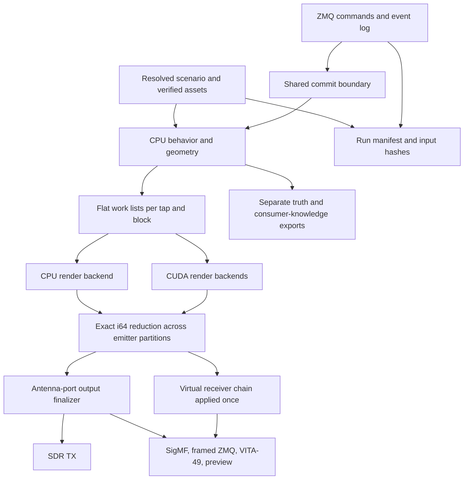

# Scenario IQ Simulator — Design Plan

Nov 6, 2026 · @Nick Stuart

Revised Nov 8, 2026 after design and implementation-prompt review.

## Purpose and scope

Build a real-time, deterministic simulator that turns RF scenarios into IQ at simulated receivers. Output streams to software consumers or SDRs, and the same inputs always produce the same samples.

**Goals**

- Real-time rendering for range scenarios, with compute that scales from CPU to one GPU to several.
- Bit-exact reproducibility: the same build, resolved scenario, seed, event log and verified input assets give identical output, identified by a run manifest.
- Streams a consumer can treat as a real passive receiver, with no truth leaking into them.
- A built-in waveform library: users configure emitters and never hand-build IQ.
- Simple install on air-gapped RHEL 9, and fast scenario authoring.

**Reference scenario.** Three aircraft with Mode A/C transponders, four fixed SSR interrogators and one fixed receiver. A geolocation service consumes the receiver's IQ, knowing only interrogator positions and nominal PRIs.

**Not in v1**

- Closed-loop HIL, where a real device must answer simulated traffic within protocol timing.
- Standards-compliant satellite bitstreams. Satellite carriers are structurally representative: framing, symbol rate, rolloff, pilots, random payload.
- Import of the existing tool's scenarios or formats.

## Requirements

Each pain point with the existing tool maps to a specific design response; the rest come from how the range will use the simulator.

| Requirement | Driven by | Design response |
| --- | --- | --- |
| Easy installation | Existing tool | One binary with CPU fallback when no GPU is present; RPM or tarball; vendored crates |
| Easy scenario authoring | Existing tool | Unit-checked, schema-validated files; platform templates; `lint` and `dry-run` |
| Motion fidelity | Existing tool | 6-DOF state; smooth (C2) maneuver-based trajectories; attitude derived from flight dynamics |
| Antenna pattern fidelity | Existing tool | Complex 3D patterns with polarization; parametric library; airframe blockage |
| Antennas placed on the airframe | Existing tool | Mounts with lever arm and orientation in the body frame |
| Terrain | Existing tool (no DTED) | DTED 0/1/2 and GeoTIFF: line of sight, diffraction, ground reflection |
| Built-in waveforms | Existing tool | Parameterized generators; IQ-file emitter as an escape hatch |
| Real-time output | Range use | Block pipeline with a fixed latency budget; underrun and strict-sink delivery deadlines are hard errors; preview loss is explicitly allowed |
| Scalable compute | Larger scenarios | Stateless kernels behind a backend trait: CPU, CUDA, multi-GPU |
| Determinism | Replay, test oracles | Integer time and phase, integer accumulation, counter-based RNG, event log |
| Runtime control | Range operations | Transport-independent command handlers, ZMQ adapters, acknowledged and deduplicated commands logged at a safe commit boundary |
| Realistic consumer view | Geolocation testing | Receiver clock model; real-receiver metadata only; truth out of band |
| Multiple receivers and channels | TDOA and AoA consumers | N receivers × M coherent channels from the start |
| Open-loop HIL | Range hardware | uhd-rs to X410 and B205mini; antenna-port tap; calibration tables |
| Satellite readiness | Roadmap | ECI light-time, relay nodes in the link graph, dense continuous rendering |

## Architecture

The simulator splits into a stateful CPU control plane and stateless render kernels, joined by a flat per-block work list.



Only the work list and referenced immutable tables cross into the render backends, so moving from CPU to one GPU to several changes no simulation logic. Each work list identifies its tap and pre-sampling response; the two tap branches represent separately rendered scenes when their responses differ. Receiver noise and other receiver effects run once after a channel's complete path sum. Stateful filters, AGC and clock processes have explicit per-channel state and ordered block handoff; parallel rendering does not reset or independently duplicate that state. Truth and consumer-knowledge exports leave from the control plane and never enter the IQ streams.

## Time, numerics and determinism

All time and carrier phase on the render path are integers, so CPU and GPU output is bit-identical and phase stays exact over long runs. Floating point appears only where its rounding is fixed by construction.

Each receiver sample is the sum over propagation paths p of a delayed, phase-rotated emitter waveform, plus receiver noise:

```latex
y_r(t) = \sum_{p} a_p(t)\, s_e\big(t - \tau_p(t)\big)\, e^{-j 2\pi f_c \tau_p(t)}\, e^{\,j 2\pi (f_c - f_{LO,r})\, t} + n_r(t)
```

Doppler and envelope compression both come from the time-varying delay τ\_p(t); there is no separate Doppler model.

**Representation**

- **Truth time:** i64 picoseconds, about 106 days of positive range from the scenario epoch. Each channel keeps a u64 sample index. The ideal sample-to-truth map is exact rational arithmetic; a receiver ClockMap supplies the perturbed sampling instants. Preserve sub-picosecond remainders through geometry and phase evaluation rather than rounding every sample to an integer picosecond.
- **Delay:** per path and block, a cubic polynomial in output-sample index, stored in Newton forward-difference form as 128-bit fixed point (64 fractional bits beyond the Q32.32 output). A thread jumps to any sample with p(k) = Δ₀ + C(k,1)Δ₁ + C(k,2)Δ₂ + C(k,3)Δ₃, then steps one sample at a time with three 128-bit adds. Wrapping integer arithmetic makes the jump and the steps agree bit for bit. The extra bits matter: over a 1 ms block at 500 MS/s, C(k,3) reaches about 2⁵⁴, so Q32.32 coefficients would leave errors far beyond the delay bound.
- **Carrier phase:** a u64 fraction of a cycle per sample, produced by the same 128-bit Newton-form polynomial. Why not f32: at τ ≈ 100 µs one f32 step is about 7.3 ps, roughly 0.05 rad at 1.09 GHz and 0.5 rad at 12 GHz.
- **Waveform coordinates:** each path also carries fixed-point retarded waveform coordinates derived from actual acquisition time minus path delay. Continuous emitters use native-sample positions relative to a source segment; pulses use emitted-time offsets in the target's declared sample units. Rebase long sources as needed to stay within the coordinate range. Subtracting a physical delay from an ideal receiver sample index would omit sampling-clock error from pulse timing and envelope resampling.
- **sin/cos:** the top phase bits index a lookup table, with a fixed-order polynomial correction. FMA contraction is disabled in kernels.
- **Amplitude:** a low-order f32 polynomial per path and block, carrying path loss, antenna gains and polarization mismatch.
- **Accumulation:** contributions use a documented physical complex-voltage normalization and a fixed i64 scale per render target, with guard bits. The antenna-port scale is independent of any virtual ADC. Specify impedance, RMS/power conventions, full scale, rounding and supported peak sum before selecting the scale. Prove headroom for the configured path count and peak amplitudes, and reject an unsafe configuration; accumulator overflow is an error. Within that bound, integer addition is associative, so thread order and GPU partitioning cannot change the result.
- **Noise:** Philox4x32-10 keyed by (scenario seed, entity, stream), with the sample index as the counter. The Gaussian transform is implemented in-house on both backends.

**Error budget.** The geometry engine fits each segment's delay, phase and amplitude polynomials, then checks endpoints and interior points against the reference models. Proposed defaults are 0.01 rad of carrier phase, 0.001 samples of delay and 0.01 dB of amplitude above a configured null floor, with an absolute complex-gain error bound near nulls (proposed 1e-3 of a declared per-link reference voltage). Phase is not tested at zero gain. Phase 1 fixes the reference normalization, null floor and sampling/refinement policy. Point checks are diagnostics rather than a proof between check points: use derivative bounds or conservative adaptive refinement on smooth intervals. Split at trajectory knots, effective parameter changes, blockage transitions and path-topology changes; map transmit-side boundaries to each path's arrival time. Never fit a smooth polynomial across a known discontinuity. Log splits and residuals, cap refinement depth and fail explicitly if the budget cannot be met.

**Determinism contract.** The same build, resolved scenario, seed, accepted event log and verified input assets produce bit-identical samples and canonical truth records on any supported backend, GPU model or partitioning. A versioned run manifest records the build identity, numeric-contract version, resolved configuration, seed, event-log identity and content hashes of all referenced libraries, terrain tiles, geoid grids, antenna data, IQ inputs and calibration tables. Live recordings and their timing/gap records become manifest assets when finalized. Replay verifies every asset before rendering and rejects missing or changed content. Performance telemetry and wall-clock diagnostics are excluded from deterministic truth hashes. Different builds are compared against stored golden outputs with stated tolerances.

The numeric contract pins operation order, float-to-integer tie rules, subnormal behavior, division and square-root modes, non-finite input rejection and compiler settings on both backends. Integer reduction alone does not guarantee identical per-path contributions. Carrier-offset phase uses modular arithmetic from exact time; long runs must not compute a large floating-point frequency-times-absolute-time value and then discard its integer cycles.

**Blocks and latency.** Rendering proceeds in blocks of receiver time (proposed default 1 ms). Pipeline depth sets the latency budget (proposed default 50–100 ms), which bounds both GPU batching and command response time.

**Commit boundary.** Rendering progress and command admission use distinct horizons. A shared exclusive boundary C covers every truth-time dependency already consumed by behavior, geometry, work-list construction, receiver processing or filter lookahead. Inputs before C are immutable. A stage reserves its dependency interval before advancing; round fractional dependency endpoints upward to the event-time grid when advancing C. Command admission and stage advancement are serialized. A command is logged and inserted at max(requested truth time, C) before a stage can advance across that effective time. v1 uses this conservative boundary without rollback. Behavior lookahead counts toward the same latency budget, and all pending commands at a boundary are ordered before advancement. Telemetry reports render progress, C and command latency separately. Replay uses the logged effective times and ingress sequence, without recalculating them from replay speed. Signals already in flight retain their emission-time parameters.

## World model

Every platform carries full 6-DOF state, because antenna gain and placement depend on attitude as much as on position.

**Frames.** WGS84 geodetic, ECEF, ECI, local NED, body and antenna frames, with quaternion rotations. Propagation is solved in ECI. Earth rotation is a fixed-rate spin from the scenario epoch; precession and nutation are below this fidelity.

**Motion sources** (one trajectory trait)

- **Maneuver primitives:** straight and level, coordinated turn, climb or descent, speed change. Jerk-limited transitions keep velocity and acceleration continuous (C2). Waypoint routes compile to primitives.
- **Derived attitude:** bank from tan φ = Vω/g, heading from track, pitch from flight-path angle; optional angle of attack and wind crab.
- **Track replay:** recorded tracks, smoothed to C2 before use.
- **Orbits:** SGP4 from TLE or OMM element sets.
- **Ground platforms:** static, or moving and clamped to terrain.

Piecewise-linear motion is not allowed: its velocity steps show up as Doppler jumps in the IQ.

**Runtime maneuvers.** A command such as "go to" or "turn to heading" appends primitives from the current state. Teleporting happens only when explicitly requested.

**Platforms and mounts.** A platform template bundles airframe geometry (for blockage), antenna mounts and default emitters. A mount is a lever arm and orientation in the body frame, plus a pattern. Lever arms change delay: 20 m of fuselage is about 67 ns.

**Mode C altitude.** Motion is geometric, but Mode C reports pressure altitude in 100 ft steps. The chain is ellipsoid height → MSL through a geoid grid → pressure altitude through the ISA, plus an optional local pressure offset, then Gillham encoding.

## Antennas and propagation

Each link expands into a small set of deterministic paths, and each path gets its own delay, phase and amplitude polynomials in the work list.

**Pattern representation.** Complex gain on a θ/φ grid, with polarization as a Jones vector, interpolated bilinearly. The format is independent of where a pattern came from, so EM-solver or measured data can be added later with no downstream changes.

**Pattern sources for v1.** No EM-solver or measured patterns exist yet, so v1 ships a parametric library:

- isotropic, dipole, monopole, and blade over a finite ground plane
- SSR large-vertical-aperture antenna with sum, difference and control patterns
- parabolic dish from diameter and efficiency; circularly polarized patch
- arrays as element pattern × array factor

Importers for FEKO, CST and HFSS far-field exports and MSI/Planet cuts follow once patterns are available.

**Installed effects.** The airframe is modeled as primitives: a fuselage cylinder plus wing and tail plates. A path whose ray from the antenna hits a primitive gets shadow loss. This reproduces effects such as belly-antenna dropouts in banked turns.

**When gains are evaluated.** TX gain is evaluated at emit time, i.e. a rotating SSR beam's gain when the pulse left. RX gain is evaluated at receive time.

**Light time.** Every path solves |r\_rx(t) − r\_tx(t − τ)| = cτ in ECI. For aircraft the correction is centimeters. A LEO satellite moves about 37 m during its light time (about 125 ns), and Earth rotation adds error on the order of 100 ns on long satellite links.

**Terrain.** DTED Levels 0, 1 and 2 and GeoTIFF elevation models, read through an in-house DTED parser and a memory-mapped tile cache. The DTED level the range will have is unknown, so all are supported, and run metadata records the terrain source and resolution. With no terrain loaded, the simulator uses a smooth Earth and warns.

**Path set per link**

- **Direct:** line of sight over the terrain profile, with Earth curvature and a refraction k-factor (default 4/3). ITU-R P.526 multiple knife-edge diffraction loss applies when the path is obstructed.
- **Ground reflection:** specular point found on the terrain; its own delay and phase; Fresnel coefficient by polarization and ground constants; roughness reduction.
- **Optional excess loss:** [Longley-Rice (ITM)](https://github.com/NTIA/itm) for beyond-line-of-sight links only. It is a statistical median-loss model, not a path model.

**Relay nodes (satellite roadmap).** A bent-pipe transponder receives, filters, frequency-translates, applies amplifier nonlinearity and re-emits, carrying uplink noise and interference through. The link graph is therefore a directed acyclic graph per block, not a set of emitter-to-receiver pairs.

## Emitters, behaviors and waveforms

Each emitter is a behavior (when and whether to transmit) plus a waveform generator (what the signal is). Both come from a library, and users configure them.

**Behavior engine.** Discrete events are ordered by (time, entity id, sequence number), so event order is deterministic. Operator commands enter as events too.

**SSR interrogator (v1)**

- Rotating antenna with a configurable scan period; PRF with stagger or jitter patterns; Mode A/C interlace.
- P1–P3 spacing of 8 µs (Mode A) or 21 µs (Mode C); P2 2 µs after P1 for sidelobe suppression.
- Sum and control patterns set the P1/P2 ratio each transponder sees.

**Mode A/C transponder (v1)**

- Decides reception at link-budget level: received P1/P3 power against sensitivity, and P2 against P1 for suppression. Its input is not rendered as IQ.
- Replies 3.0 ± 0.5 µs after P3, with jitter; framing pulses 20.3 µs apart, code pulses, SPI.
- Per-unit carrier offset within 1090 ± 3 MHz; dead time and suppression windows.
- Squawk set in the scenario or at runtime; Mode C altitude from the world model.

**Rendering paths.** Pulses have parameterized rise and fall and are rendered analytically at exact sub-sample delay, from band-limited edge tables (see Receiver model). Continuous waveforms are generated once at their native rate, then filtered to each channel's band and resampled per path with a Farrow fractional-delay filter.

**Library roadmap**

1. Mode A/C interrogator and transponder
2. Mode S and ADS-B (1090ES squitters), DME, generic pulsed radar
3. AM, FM, generic PSK and QAM
4. DVB-S2-structured carriers: framing, pilots, symbol rate, rolloff, random payload

An IQ-file emitter is delivered in phase 2 (prompt 6a). It reads SigMF ci16_le or cf32_le captures, has explicit frequency, rate, level, start-time and end/loop behavior, and uses the same pre-sampling filtering and fractional-delay path as later continuous waveforms. Its source bytes and metadata are hashed in the run manifest.

## Receiver model

Every receiver exposes two tap points: the antenna-port scene, for driving real hardware, and the full receiver chain, for virtual receivers.

**Structure.** N receivers, each with M coherent channels sharing a sampling oscillator, timestamp-clock model and common LO error process. Each channel has its own center frequency, sample rate and bandwidth; digital tuning phases and channel offsets are explicit. Evaluate common clock and LO processes at shared physical times so channels with different rates remain coherent.

**Chain, in order**

1. Front-end gain and noise figure
2. Thermal noise (kTBF), shaped to the channel response
3. LO offset and phase noise
4. IQ imbalance and DC offset
5. Digital decimation filter, if the profile has one
6. Optional AGC
7. ADC quantization and clipping

**Band-limiting before sampling.** Every render target declares a response that prevents aliasing at its output rate. The virtual-receiver tap uses its analog front-end and anti-alias response H_rx(f). The antenna-port tap uses a separately specified output band-selection response B_out(f), chosen for the DAC/output channel, with no virtual receiver passband, gain or group delay. Render separate work lists when these responses differ, and include the tap and response identity in cached-table keys. Filtering after sampling cannot remove what has already aliased: a 1030 MHz interrogation rendered at 16 MS/s into a channel centered at 1090 MHz is 60 MHz away and folds to 4 MHz from center.

- **Narrowband emitters:** the selected response at the emitter's offset frequency, gain and phase, folds into the path's amplitude and phase polynomials. Paths whose in-band contribution falls below a threshold are culled.
- **Analytic pulses:** rendered from complex band-limited edge tables (the edge shape convolved with the selected response, shifted to the emitter's offset), built deterministically before use. Runtime frequency or response changes create a new cached table before the effective boundary.
- **Wideband modulated emitters:** filtered to the channel band inside the resampler, before the fractional delay; cost scales with the emitter's own rate.

Front-end compression by strong out-of-band signals is a separate effect, left for a later phase.

**Clock model.** Distinguish three effects: (1) the sampling oscillator maps sample index to actual truth-time acquisition instant, including frequency error, drift and aging; (2) the timestamp clock maps that instant to the time reported to the consumer, including its own offset and drift; (3) the LO model controls mixing phase and frequency error. Their coupling is explicit in a receiver profile, with an optional GPSDO-disciplined model. A deterministic, monotone ClockMap and its inverse drive geometry, propagation delay and phase at the actual acquisition instants. Timestamp-only relabeling cannot model a sampling-oscillator error. Until phase 5 the ideal ClockMap implements the same interface. Stream timestamps come from the timestamp clock, while truth exports record both times and sample indices. Antenna-port/HIL rendering uses the declared output-device timebase and bypasses virtual clock and LO impairments.

**Reference receiver for Mode A/C.** Either two channels at 1030 and 1090 MHz, or one wideband channel spanning both (about 70 MHz or more). For HIL playback, a single B205mini channel cannot span both bands; an X410 can.

## Compute backends and scaling

Backends are interchangeable consumers of the block work list. The CPU backend is the golden reference, and every other backend must match it bit for bit.

**Backends**

- **CPU:** SIMD on stable Rust (no nightly features), multithreaded across receivers and blocks.
- **CUDA:** host side on [cudarc](https://github.com/chelsea0x3b/cudarc); kernels in CUDA C, compiled offline to fatbins for sm\_75 and sm\_86 with FMA contraction off. cudarc loads CUDA dynamically, so the same binary falls back to CPU on a machine with no GPU.
- **Multi-GPU:** split by receiver and channel first, so most scenarios need no cross-GPU sums. Emitters are split across GPUs only when one receiver outgrows a card. In that mode every device returns raw i64 I/Q partial sums before noise, receiver effects or output conversion; the host reduces them exactly. The complete sum is finalized once, on the host or one designated device, with ordered ownership of receiver state.

Transfers are PCIe-only. When a GPU owns a complete channel, its final output can be converted to sc16 before transfer, so a 100 MSPS channel moves 400 MB/s. Emitter partitions transfer two i64 values per complex sample: 1.6 GB/s per partition at 100 MS/s, before any return transfer for finalization. Include that traffic and shared PCIe links in partitioning and capacity estimates.

**Hardware**

| GPU | Architecture | FP32 peak | Memory bandwidth | Memory | Role |
| --- | --- | --- | --- | --- | --- |
| [NVIDIA T1000](https://www.pny.com/en-eu//nvidia-t1000-8gb) × 4, one host | Turing, sm\_75 | 2.5 TFLOPS each | 160 GB/s each | 4 or 8 GB each (to confirm) | Range target |
| RTX 3060 | Ampere, sm\_86 | about 12.7 TFLOPS | about 360 GB/s | 12 GB | Development box |

T1000 FP64 runs at 1:32 of FP32 ([specs](https://fpsbench.com/gpu/nvidia-t1000)), which is why f64 stays off the device. Buffers are sized for 4 GB per card until memory is confirmed. RTX 3060 figures are approximate, not looked up.

**Testing across hardware**

- CPU, RTX 3060 and T1000 output must hash identically for the same run.
- Multi-GPU split logic is tested at home by dividing work between the GPU and the CPU backend, then matching an unsplit run.
- Performance acceptance runs on the T1000 host; the 3060 overstates per-card capacity by about 5×.

**Capacity estimate (measured in phase 7).** Dense continuous rendering is limited by memory bandwidth. At 10–20 bytes of traffic per path-sample, a T1000 peaks near 10¹⁰ path-samples per second, and realistically several times lower. That is roughly a few dozen dense carriers into one 100 MSPS receiver per card. Pulsed Mode A/C uses a small fraction of that. The estimate assumes Newton-form polynomials; evaluating them from scratch at every sample would cost several times more on a GPU, where 64-bit multiplies are emulated.

## Interfaces

The simulator defines and versions all of its interfaces. Command handlers and IQ framing are independent of transport adapters. The existing range control tool adapts to this schema.

**Transport decision and alternatives.** Keep ZMQ for native control and telemetry because the range already has a ZMQ client, it runs without a broker, and the command traffic is small. IQ delivery has different requirements, so choose its transport and loss policy per sink. This is a design choice to validate with the real consumer and target host, rather than a throughput claim based on a library name.

| Option | Fit and tradeoff | Decision for v1 |
| --- | --- | --- |
| ZMQ ROUTER/DEALER | Native command routing and multipart binary messages; application-level acknowledgements, retries and deadlines remain our responsibility | Native control adapter and strict framed software-IQ sink |
| ZMQ PUB/SUB | Simple fan-out and existing GNU Radio integration; a slow subscriber can lose messages | Best-effort telemetry and raw IQ preview |
| VITA-49 over UDP | Receiver-oriented signal/context packets; UDP delivery requires consumer-side loss detection | Primary receiver-interoperability IQ format; explicit continuity checks |
| HTTP/JSON + WebSocket, or gRPC | HTTP suits the browser editor; gRPC offers generated RPC APIs and streaming but introduces another interface/tooling stack | HTTP/WebSocket adapter in phase 12 over the same handlers; reconsider gRPC if a consumer requires it |
| Plain framed TCP, DDS, shared memory | TCP would require our own framing/session handling; DDS adds discovery/QoS deployment choices; shared memory only addresses local delivery | Revisit for a concrete integration or measured bottleneck; keep sink interfaces replaceable |

The socket semantics above follow the [ZMQ socket reference](https://zeromq.github.io/libzmq/zmq_socket.html) and [socket-option reference](https://zeromq.github.io/libzmq/zmq_setsockopt.html). The alternatives were checked against [gRPC core concepts](https://grpc.io/docs/what-is-grpc/core-concepts/), [DDS discovery](https://fast-dds.docs.eprosima.com/en/stable/fastdds/discovery/discovery.html) and the [VITA-49 FAQ](https://vita.com/page-1855471). A framed-IQ receiver needs the supplied adapter; stock GNU Radio ZMQ sources are supported by the separate raw preview format.

**Scenario files**

- TOML: strict, unambiguous and well supported in Rust. A JSON Schema generated from the Rust types drives validation and editor autocompletion.
- Unit-aware values ("250 kt", "FL350", "1090 MHz"); positions in decimal degrees, DMS or MGRS.
- Library items (platform templates, antennas, waveforms, receiver profiles) are referenced by name from a search path.

**CLI**

- `sim lint`: schema, units, references, unattached antennas, and HIL mappings against device limits.
- `sim dry-run`: per-link visibility over time, predicted SNR, emitters outside every receiver's band, terrain coverage, and aggregate sink/partition traffic against shared NIC, disk, USB and PCIe capacity.
- `sim run`: offline (as fast as possible) or real time.
- `sim replay <run-manifest>`: verifies the resolved scenario, build, event log and input assets, then re-renders the run. The manifest and truth exports stay out of consumer-visible metadata.

**Control plane (ZMQ)**

- A ROUTER socket takes commands from DEALER clients, with ROUTER_MANDATORY, bounded queues and send deadlines. Each accepted-command ack follows durable event-log append and returns the effective truth time and ingress sequence. Delivery failure is reported, and a client can query command/run status.
- A PUB socket sends best-effort operator telemetry: entity states, link status, render margin and underruns. Include telemetry sequence numbers and expose a status/snapshot request for resynchronization. Operator telemetry is separate from consumer-visible IQ metadata.
- Messages are JSON in a versioned envelope (schema version, message type, client/session id, request id, payload). Deduplicate command retries by client/session and request id; a retry returns the original outcome without scheduling the action again. The JSON Schema is generated from the Rust types and published for adapters.
- Commands: maneuver, add or remove entity, enable or disable emitter, set parameters (squawk, power, frequency), inject noise or jamming, start and stop.
- Effective time is the later of the requested time and the shared exclusive commit boundary C, admitted atomically as defined under Time, numerics and determinism. Record both times, ingress sequence, request identity and outcome. Replay uses accepted effective times directly. Start, stop, rejection and pending-command handling have explicit log records; stopping may drain already committed output and returns the final output boundary.

**IQ outputs**

- **Strict framed ZMQ over TCP or IPC:** a ROUTER/DEALER session routes each configured receiver channel to its registered consumer, with dedicated per-consumer queues and explicit fan-out when requested. Each binary IQ message has a versioned header with stream/session identity, block sequence, first sample index, sample count, datatype/byte order, receiver-reported first-sample timestamp and context version. Context carries RF reference frequency, sample rate, bandwidth and gain. No truth fields or manifest are sent. Use a READY handshake, consumer acknowledgements of contiguous received blocks, bounded outstanding-byte/ack windows and a final acknowledged end-of-stream boundary. Sending into a queue is not proof of delivery. A disconnect, missing acknowledgement or backpressure beyond the configured real-time deadline fails the required sink and run; automatic reconnect never silently resumes a successful stream. Offline transfer can wait within its configured operation timeout. Supply a reference receiver and GNU Radio adapter.
- **VITA-49 over UDP:** signal data packets with stream identifiers, packet counts and receiver-clock timestamps, plus context packets carrying RF reference frequency, sample rate, gain and bandwidth. Pin a documented VITA 49.2 interoperability profile, timestamp units, MTU and context cadence. The supplied receiver checks continuity using packet counts together with timestamps and payload sample counts, including packet-count wrap; it reports loss, reordering and duplicates and fails strict consumption on gaps. UDP send success does not establish remote delivery. A run requiring sender-visible end-to-end confirmation uses the strict framed sink; VITA-49 alone promises paced production with detectable discontinuities at the consumer.
- **Raw ZMQ PUB preview:** sc16 or fc32 sample items readable by GNU Radio ZMQ SUB Source blocks and spectrum tools. Explicitly best effort: subscriber startup or queue overflow can lose samples, and raw items carry no gap/timing header. Preview loss does not block required sinks; the producer cannot claim to count every subscriber loss. This format cannot satisfy strict continuity or TDOA timestamp acceptance.
- **SigMF recordings:** sequential files with checked write errors and a finalized sample count/hash. Truth annotations go in a separate sidecar file, so the recording a consumer sees stays clean. Real-time recording shares the sink deadline and resource budget; offline recording is unpaced.

In real time, the network link bounds total output: roughly 30 MS/s of sc16 per 1 GbE and 300 MS/s per 10 GbE before a configured headroom allowance; fc32 halves both. Declare resource identities for every sink and device (NIC, disk, USB controller, PCIe link/root) with usable capacities. Sum concurrent traffic, packet/framing/ack overhead, copies for fan-out and i64 partition transfers along every shared resource. Two 20 MS/s sc16 sinks sharing 1 GbE require 1.28 Gb/s before overhead and must fail the real-time budget check even though each sink fits alone. Unknown capacity is reported as unverified; physical measurements establish usable limits. Hard producer underruns and strict-sink deadline failures are distinguished from best-effort preview loss and consumer-detected UDP loss.

**Exports**

- **Truth log** (Parquet): entity states, every emission, and causal links such as reply → triggering interrogation, all mapped to receiver sample indices.
- **Consumer-knowledge file** (JSON): interrogator positions (optionally with survey error), nominal PRI and scan schedules, receiver site. The truth carries the real PRI stagger; this file carries only nominal values.

## Hardware in the loop

v1 supports open-loop HIL in both directions. Closed loop is deferred.

**Out: simulation → SDR TX**

- uhd-rs (libuhd FFI) drives the X410 and B205mini. ruhd can replace it later behind the same sink trait.
- The antenna-port tap is rendered with B_out(f) for the selected output rate/device. It excludes the virtual receiver's H_rx(f), gain, clock/LO errors, noise and ADC effects. The real receiver supplies its own response. Calibration includes the actual output chain.
- The device's sample clock paces the pipeline through UHD backpressure. Wall-clock pacing is used only with no hardware attached; the two are never mixed.
- Calibration tables per device, channel and frequency, plus per-path losses through the Quintech matrix and cabling, set absolute power at the device under test.
- Multiple devices align through shared 10 MHz and PPS references and UHD timed commands.

**In: SDR RX → simulation**

- A real emitter captured on an SDR becomes a scenario emitter and passes through the simulated channel.
- The exact samples accepted into the simulation, source metadata, timestamps and any gap/overrun decisions are recorded and added to the run manifest. Replay reads those bytes and timing records through the same source interface.
- Output runs a fixed latency behind real time; the latency budget absorbs capture and transfer jitter.

**Device limits.** `sim lint` rejects HIL mappings that exceed the mapped radio's limits.

| Radio | Channels (TX × RX) | Tuning range | Bandwidth per channel | Max sample rate | Host link |
| --- | --- | --- | --- | --- | --- |
| [X410](https://ni.com/docs/en-US/bundle/ettus-usrp-x410-specs/page/specs.html) | 4 × 4 | 1 MHz–7.2 GHz | 400 MHz | 491.52 or 500 MS/s | Two QSFP28; four channels at 400 MHz need dual 100 GbE ([source](https://www.sdrstore.eu/usrp-n310-vs-x410-4x4-mimo-bandwidth-fpga-networking/)) |
| [B205mini](https://digilent.com/shop/ettus-usrp-b205mini-i-1x1-70mhz-6ghz-sdr-cognitive-radio/) | 1 × 1 | 70 MHz–6 GHz | 56 MHz | 61.44 MS/s | USB 3.0 |

Ku- and Ka-band links need the range's external up- and downconverters, included in the calibration path.

**Deferred: closed loop.** A real transponder answering a simulated interrogation must reply within 3 µs, so the host cannot sit in that path. Supporting it would need channel emulation on the FPGA.

## Validation strategy

Every model is checked against an independent reference before it is trusted. The pass criteria are proposals, to be settled in phase 1.

Prompt 0 records the initial numeric, timebase, resource and transport contracts in docs/contracts.md; phase 1 fixes the proposed tolerances and records any changes there before render implementation. Acceptance distinguishes sample hashes and canonical truth hashes from nondeterministic telemetry and container-file metadata.

| Check | Method | Proposed pass criterion |
| --- | --- | --- |
| Delay | Static link; measure pulse time of arrival against truth | Within the configured delay bound |
| Doppler and phase | Moving CW emitter; estimated phase trajectory against the analytic solution | Within the configured phase bound |
| Power | Received power against a closed-form link budget | ±0.1 dB |
| Noise floor | Measured PSD against kTBF and noise figure | ±0.2 dB |
| Determinism | Repeat runs; CPU vs GPU; 3060 vs T1000; split vs unsplit | Identical output hashes |
| Replay inputs | Modify or remove a library, terrain tile, calibration or IQ input after recording | Replay rejects a manifest mismatch before rendering |
| Receiver clocks | Two receivers observing analytic CW and timed pulses, with independent sampling and timestamp errors | IQ timing/phase follows actual acquisition instants; metadata follows the timestamp clock |
| Command causality | Commands arrive after behavior lookahead and during long-delay propagation | No committed state is changed; accepted events replay identically |
| Mode A/C protocol | Decode replies with an independent decoder | Squawk and altitude match truth; reply-delay statistics match the model |
| Geolocation chain | Independent bistatic-ellipse estimator using only receiver IQ and consumer-knowledge data; truth used only to score results | Noiseless solution and seeded timing-error cases meet a declared error budget and report ambiguities |
| Real time | Multi-hour run at target load on the T1000 host | Zero underruns |
| Diffraction | Knife-edge cases against an independent P.526 implementation | Agreement within 0.1 dB |
| HIL power | Analyzer at the device under test against commanded power | Within calibration tolerance |
| Realism | Comparison with real 1030/1090 MHz captures, where permitted | Pulse shape, spectrum and reply-rate statistics agree |
| Out-of-band rejection | Emitters outside and straddling a channel, e.g. 1030 MHz interrogations into a 1090 MHz channel | No aliased images; in-band level matches the selected H_rx or B_out within 0.1 dB |
| Tap isolation | Change virtual H_rx, gain, noise and clock settings while holding the antenna-port output configuration fixed | Antenna-port hash unchanged; virtual-receiver response changes as predicted |
| Gain transitions | Antenna nulls, a blockage crossing and path appearance inside a block | Amplitude/phase budgets hold on smooth intervals; transitions create explicit boundaries |
| Transport delivery | Late join, stalled consumer, disconnect, lost ACK, UDP loss/reordering and packet-count wrap | Strict ZMQ completes an acknowledged stream or fails; VITA receiver detects discontinuities; preview behavior is documented |
| Shared output capacity | Individually valid sinks oversubscribing one NIC/disk and emitter partitions sharing PCIe | Real-time lint rejects the aggregate overload |

## Phase plan

Twelve phases, each ending in acceptance checks. The reference Mode A/C scenario runs end to end offline at phase 4 and in real time at phase 5.

1. **Foundations:** workspace, time and fixed-point phase types, Philox, unit-aware parser, schema generation, CI with golden-hash tests.
   - Accept: property tests on fixed-point arithmetic pass; the schema validates sample scenarios.
2. **Static render on CPU:** CW, pulse and IQ-file emitters, static geometry, separate antenna-port and virtual-receiver targets, SigMF output and run manifests.
   - Accept: delay, power, noise-floor, tap-isolation and fractional-delay IQ-file checks pass.
3. **Motion and channel:** maneuver trajectories, attitude, ECI light-time, polynomial fitting with the error budget, parametric antennas and mounts, airframe blockage.
   - Accept: Doppler, phase and amplitude checks pass; discontinuities and error-budget subdivisions are logged.
4. **Mode A/C end to end, offline:** event engine, interrogators, transponders, truth and knowledge exports.
   - Accept: independent decoder and consumer-only geolocation checks pass; repeat runs hash identically.
5. **Real time and control:** pacer, bounded pipeline/commit boundary, physical receiver clocks, strict framed ZMQ and VITA-49 outputs, preview, control plane, event log and manifest-based replay.
   - Accept: the reference scenario sustains real time on CPU; delivery/clock/command-causality tests pass; a run with live commands replays bit-exact.
6. **Authoring and packaging:** `lint`, `dry-run`, platform and receiver templates, RPM and tarball with vendored crates.
   - Accept: a fresh air-gapped install reaches a first scenario run by following only the docs.
7. **CUDA and multi-GPU:** kernels, sm\_75 and sm\_86 fatbins, receiver partitioning.
   - Accept: CPU, 3060 and T1000 hashes match; a capacity benchmark is recorded on the T1000 host.
8. **Terrain:** DTED and GeoTIFF loading, line of sight, diffraction, ground-reflection paths.
   - Accept: diffraction reference cases agree; reflection geometry checks pass.
9. **HIL:** uhd-rs TX sink, calibration workflow, RX injection.
   - Accept: power at the device under test is within tolerance; a real receiver decodes the injected Mode A/C.
10. **Waveform expansion:** Mode S and ADS-B, DME, pulsed radar, AM, FM, PSK and QAM.
    - Accept: independent decoders or demodulators recover each waveform.
11. **Satellite:** SGP4, relay nodes, DVB-S2-structured carriers, dense rendering.
    - Accept: LEO Doppler and light-time checks pass; an independent demodulator detects the frame structure.
12. **Map-based scenario editor:** a web GUI over the control plane, with a DTED shaded-relief basemap.
    - Accept: the reference scenario can be built and run without editing files.

Sequenced implementation prompts for every phase: [agent_prompts.md](agent_prompts.md).

## Open items and risks

**Open items**

- [ ] Confirm T1000 memory (4 or 8 GB) and the host's PCIe slot widths.
- [ ] Confirm which DTED level the range will have, and pick terrain validation sites.
- [ ] Pin CUDA toolkit and driver versions for air-gapped RHEL 9.
- [x] Scenario file format: TOML.
- [ ] List the fields the geolocation consumer needs in VITA-49 context packets.
- [ ] Validate the transport profile with the geolocation consumer: VITA-49 continuity reporting or strict framed ZMQ adapter, required rates, timestamp interpretation and failure handling.
- [ ] Confirm shared NIC/disk/USB/PCIe topology and measure usable capacity; benchmark the chosen IQ sinks on the target host.
- [ ] Find real 1030/1090 MHz captures that can be used for realism checks.
- [ ] Obtain EM-solver or measured patterns for the main platforms, when available.

**Risks**

- **Bit-exactness costs throughput.** Disabling FMA and using in-house sin/cos slows kernels; phase 7 measures the cost against the T1000 budget.
- **Parametric patterns limit installed-pattern fidelity.** Until real patterns exist, the blockage model captures only gross shadowing.
- **T1000 headroom.** Four T1000s roughly equal one RTX 3060 in FP32, so dense satellite scenarios may need better GPUs. The backend design allows that upgrade with no code changes.
- **CPU real-time margin.** For pulsed scenarios, noise generation at high sample rates dominates CPU load; phase 5 measures the margin.
- **Delivery and commit latency.** Bounded consumer acknowledgements and conservative command admission consume latency budget. Phase 5 measures both under load; preview subscribers cannot stall required sinks.
